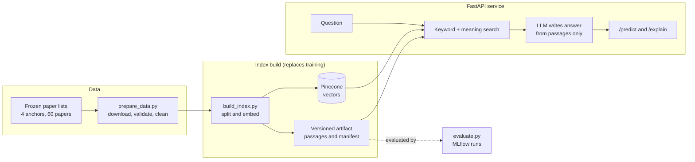

# Anchor Paper RAG

Ask questions about four research papers and the papers that cite them, and get answers written only from those papers, with sources named.

## Architecture



## Quick start

You need Python 3.11, internet access and these keys in a `.env` file:

| Key | Needed for | Where to get it |
|---|---|---|
| `OPENAI_API_KEY` | Embeddings. A full index build costs about $0.02. | [platform.openai.com](https://platform.openai.com/api-keys) |
| `PINECONE_API_KEY` | Storing vectors. The free plan is enough, and it needs 1 free index slot. | [app.pinecone.io](https://app.pinecone.io) |
| `GEMINI_API_KEY` | Writing answers. Free. | [aistudio.google.com/apikey](https://aistudio.google.com/apikey) |

To avoid the OpenAI key, see [Running without an OpenAI key](#running-without-an-openai-key).

**Linux or macOS:**

```bash
git clone https://github.com/Rockybhaie/anchor-paper-rag-pipeline.git && cd anchor-paper-rag-pipeline
make setup                 # Then add your keys to .env
make data                  # Download and prepare the papers
make index                 # Build the search index
make serve                 # Start the API
```

**Windows PowerShell:**

```powershell
git clone https://github.com/Rockybhaie/anchor-paper-rag-pipeline.git; cd anchor-paper-rag-pipeline
py -3.11 -m venv .venv; .\.venv\Scripts\Activate.ps1
pip install -r requirements-dev.txt
copy .env.example .env     # Then add your keys to .env
python -m src.prepare_data # Download and prepare the papers
python -m src.build_index  # Build the search index
uvicorn src.app:app        # Start the API
```

Open <http://127.0.0.1:8000/docs> to try the API.

On Windows, keep the project in a fairly short folder path. Some dependencies have deep file paths, and `pip install` fails if a path passes Windows' 260-character limit.

The first setup is a one-time step that can take up to about an hour on a laptop: installing packages, downloading 60 papers, and uploading vectors to Pinecone. After that, the API starts in seconds and never downloads papers.

### Try it

```bash
curl -X POST http://127.0.0.1:8000/predict \
  -H "Content-Type: application/json" \
  -d '{"anchor_id": "titans", "question": "How does Titans use surprise when updating its memory?"}'
```

| Endpoint | What it does |
|---|---|
| `POST /predict` | Answers the question and names the source papers. |
| `POST /explain` | Returns the passages used and the paper each came from. |
| `GET /docs` | Interactive API documentation. |

`anchor_id` must be `nested_learning`, `titans`, `ttt_rnn` or `hrm`. The question must be 5 to 500 characters. Anything else returns a 422 error.

### Running without an OpenAI key

`configs/free.yaml` uses a local embedding model and needs only `GEMINI_API_KEY` and `PINECONE_API_KEY`.

```powershell
python -m src.build_index --config free
$env:ANCHOR_RAG_CONFIG="free"; uvicorn src.app:app   # Linux or macOS: ANCHOR_RAG_CONFIG=free uvicorn src.app:app
```

## Dataset and task

**Task:** answer questions using only retrieved passages. This is a retrieval-augmented question-answering system, not a classifier, so it has no training step. Building the search index takes the place of training, and evaluation scores the answers.

| Anchor (`anchor_id`) | Paper | Papers in corpus | Passages served |
|---|---|---|---|
| `nested_learning` | Nested Learning: The Illusion of Deep Learning Architectures | 15 | 1,391 |
| `titans` | Titans: Learning to Memorize at Test Time | 15 | 1,251 |
| `ttt_rnn` | Learning to (Learn at Test Time): RNNs with Expressive Hidden States | 15 | 981 |
| `hrm` | Hierarchical Reasoning Model | 15 | 940 |

Each corpus is the anchor plus 14 papers that cite it. No paper appears in two corpora.

- **Anchor 1** keeps the 15 papers chosen by hand in the earlier project.
- **The other three** were shortlisted from Semantic Scholar by `src/collect_citations.py`, scored by an LLM on the earlier project's criteria, and approved by the team.

Full papers are not stored here. The lists are frozen in `data/anchors/<anchor>/manifest.json`, and `src/prepare_data.py` downloads the papers from them. Preparation checks that each file is a real PDF, flags a changed file hash, removes references, and rejects papers with too little readable text. A clean clone therefore never depends on Semantic Scholar.

## Evaluation and best run

As the course asks for RAG projects, MLflow records evaluations of the system's inference, not training cycles. **Faithfulness**, the share of an answer's claims that the retrieved passages support, is the one metric used to choose. Relevancy, whether the right paper was found, refusals, latency and cost are logged alongside it.

**Questions:** 120 new questions, 30 per anchor, with about 1 in 5 comparing two papers. 15 per anchor choose the setup, and 15 are held back for the final score.

**Stages:** each stage tries a few settings on one anchor and passes its winners on, so not every combination runs on every anchor.

| Stage | Anchor | Setting | Tried (faithfulness) | Chosen |
|---|---|---|---|---|
| 1 | Nested Learning | Judge | 5 judge options, see below | `gpt-4o-mini` with rubric |
| 1 | Nested Learning | Chunking | fixed 512/50 0.891, recursive 400/80 0.921, recursive 800/120 0.950, semantic 0.921 | recursive 800/120 |
| 1 | Nested Learning | Embeddings | `text-embedding-3-small` 0.950, `all-MiniLM-L6-v2` 0.937 | `text-embedding-3-small` |
| 2 | Titans | Retrieval | meaning 0.938, keyword 0.978, hybrid 0.944, hybrid + rerank 0.938 | keyword |
| 2 | Titans | Passages | 3: 0.965, 5: 0.978, 8: 0.972 | 8 (close tie, better relevancy) |
| 3 | TTT RNNs | Prompt | P0 0.948, P1 0.982, P2 0.963, P3 0.990, P4 0.935 | P1 (close tie, better relevancy) |
| 4 | Hierarchical Reasoning | Model | `gpt-4o-mini` 0.974, `gpt-5-nano` 0.963, `gemini-3.5-flash-lite` 0.967, `gpt-oss-20b` 0.922 | `gpt-4o-mini` |
| 4 | Hierarchical Reasoning | Temperature | 0.0: 0.986, 0.1: 0.974, 0.4: 0.946, 0.7: 0.970, 1.0: 0.957 | 0.0 |

A setup can't win by rarely answering: runs that refuse more than 34% of questions, or answer fewer than 80%, are ruled out. Near ties within 0.01 go to higher relevancy, then lower latency.

**Judges:** one chosen judge scores everything after the judge test, because scores from different judges can't be compared. It was picked by scoring each answer against its real passages and against unrelated ones. The judge with the largest gap won, not the one giving the highest scores.

### Final scores on the 60 held-back questions

| Setup | Retrieval | Generator | Faithfulness | Relevancy | Relevancy when answered | Right paper found | Refusals | Avg time |
|---|---|---|---|---|---|---|---|---|
| C: top score | Keyword | `gemini-3.5-flash-lite` | **0.985** | 0.717 | 0.717 | 0.98 | 10% | 10.1 s |
| **D: served** | **Hybrid** | **`gemini-3.5-flash-lite`** | **0.978** | 0.705 | 0.702 | 0.97 | **5%** | 10.3 s |
| E | Hybrid | `gpt-4o-mini` | 0.962 | 0.738 | 0.736 | 0.97 | 7% | 3.9 s |
| A: all stage winners | Keyword | `gpt-4o-mini` | 0.956 | 0.738 | 0.734 | 0.98 | 7% | 2.2 s |
| B: earlier project's setup | Hybrid + rerank | `gpt-4o-mini` | 0.928 | **0.771** | **0.755** | 0.96 | 18% | 3.6 s |

All setups except B use recursive 800/120 chunks, 8 passages, prompt P1 and temperature 0.0. B keeps recursive 400/80, 5 passages, prompt P0 and temperature 0.1. A refusal is an answer with a known refusal phrase, or one where the judge finds no factual claims.

### Best run and why

**Setup C has the highest score (0.985), but we serve setup D (0.978).** The two are 0.007 apart, which is too small to treat as a real difference on 60 questions. We chose D because:

1. **It searches by meaning as well as keywords,** as the project proposal describes. Keyword-only retrieval never queries Pinecone when answering.
2. **The test questions favour keyword search.** Our question rules told the generator to name the method being asked about, so exact-word matching has an easy job. Real users paraphrase.
3. **It refuses least and is the most consistent.** It refuses 5% of questions against 10% for C, and its faithfulness ranges from 0.976 to 0.979 across anchors, against 0.964 to 0.993 for C.

D scores 0.05 higher on faithfulness than the earlier project's setup, and refuses far less often (5% against 18%). It costs some relevancy (0.702 against 0.755 on questions it answers) and is slower, about 10 seconds against 3.6, mostly because the free model responds slowly.

Setups D and E were added after the first held-back results, once keyword search was seen to bypass Pinecone. Their comparison with A, B and C is therefore slightly less clean than a fully pre-planned one.

### Limits of these results

- Each stage uses 15 questions on one anchor, so a winner there may not be best elsewhere, and small gaps may be noise. Setup A, built from every stage winner, was beaten by C, which changed only the generator.
- Questions and reference answers were written by an LLM from the papers. They test finding and using what is in the corpus, not what real researchers would ask. The team removed 13 questions that did not stand alone.
- `gpt-4o-mini` judges its own answers in setups A, B and E, which may flatter them or count against them. Faithfulness cannot catch an answer that is faithful to the wrong passages, which is why right-paper rate is logged too.
- Faithfulness and relevancy are themselves LLM judgements and vary slightly between runs. Plain relevancy can also flatter refusals, which repeat the question's words, so we log relevancy on answered questions too.

### See the results

The full run history is committed, so no keys or spending are needed:

```bash
mlflow ui --backend-store-uri sqlite:///mlflow.db    # Then open http://127.0.0.1:5000
```

- [reports/milestone1_report.pdf](reports/milestone1_report.pdf) has the results and MLflow screenshots.
- [results/side_by_side.md](results/side_by_side.md) shows the same question answered under each setting.
- [results/summary.csv](results/summary.csv) has every run's metrics.

To rerun the evaluation, use `python -m src.evaluate`. Saved answers are reused, so this costs nothing unless a setting changes. The whole evaluation cost about $0.47. It stops itself if estimated spend passes $3.

## Tests

```bash
pytest          # Or: make test
ruff check .    # Or: make lint
```

The tests use stand-ins for OpenAI, Gemini, Groq and Pinecone, so they need no keys and no network. They cover data preparation, index loading, retrieval, generation, the judge, the evaluation and MLflow logging, and the API endpoints. GitHub Actions runs both commands on every push.

## Project layout

```text
configs/    Anchors, baseline, staged evaluation, served setup, free setup
prompts/    Prompt options for generation, the judge and question writing
data/       Frozen paper lists and golden questions (papers are downloaded, not stored)
src/        collect_citations, prepare_data, build_index, evaluate, app and their helpers
tests/      pytest tests
results/    Saved answers and scores, summary tables, side-by-side answers
reports/    Milestone report and MLflow screenshots
tools/      Scripts that rebuild the report and screenshots
mlflow.db, mlartifacts/    The MLflow run history
```

`src/build_index.py` is the RAG equivalent of a training script. It saves a versioned artifact such as `artifacts/indexes/titans/recursive-800-120__text-embedding-3-small__v1/`, which the API loads at startup.

## Changes from the proposal

| Proposal | Now | Why |
|---|---|---|
| Any anchor paper at runtime | 4 predefined anchors | Scope for this milestone |
| Read Google Scholar's Cited by page | Semantic Scholar API, frozen lists | An official API that doesn't depend on reading a web page, and a clean clone never needs it |
| Local index (the slides mentioned Pinecone) | Pinecone | Team decision |
| Three MLflow runs | 57 runs across prompts, models, parameters, temperature and judges | The course's RAG update |

## Reused work and credits

**Earlier project:** this project builds on our earlier work, [Tracking the Evolution of Nested Learning via RAG](https://github.com/Rockybhaie/Tracking-the-Evolution-of-Nested-Learning-via-RAG), which supplied anchor 1's paper selection, the text cleaning steps, the chunking settings, the retrieval design, the first prompts and the judge approach. Three of anchor 1's PDFs are downloaded from that repository, because their original sites block scripts. We also fixed problems in it, including a 2,500-character limit on what the judge could read, which appears to have favoured the shortest chunks.

**Libraries:** [FastAPI](https://fastapi.tiangolo.com), [MLflow](https://mlflow.org), [Pinecone](https://www.pinecone.io), [OpenAI Python](https://github.com/openai/openai-python), [PyMuPDF](https://pymupdf.readthedocs.io), [rank-bm25](https://github.com/dorianbrown/rank_bm25), [LangChain Text Splitters](https://python.langchain.com), [FastEmbed](https://github.com/qdrant/fastembed), [Playwright](https://playwright.dev), pytest and Ruff.

**Models:** `all-MiniLM-L6-v2` and `ms-marco-MiniLM-L-6-v2` from Hugging Face. `gpt-4o-mini`, `gpt-5-nano` and `text-embedding-3-small` from OpenAI, `gemini-3.5-flash-lite` from Google, and `gpt-oss-20b` through Groq.

**Data:** citation data from [Semantic Scholar](https://www.semanticscholar.org). Papers belong to their authors and are downloaded from [arXiv](https://arxiv.org) and the earlier project's repository.

See [CONTRIBUTION.md](CONTRIBUTION.md) for who did what, [AI_USAGE.md](AI_USAGE.md) for how AI tools were used, and [LICENSE](LICENSE) for the MIT license.
